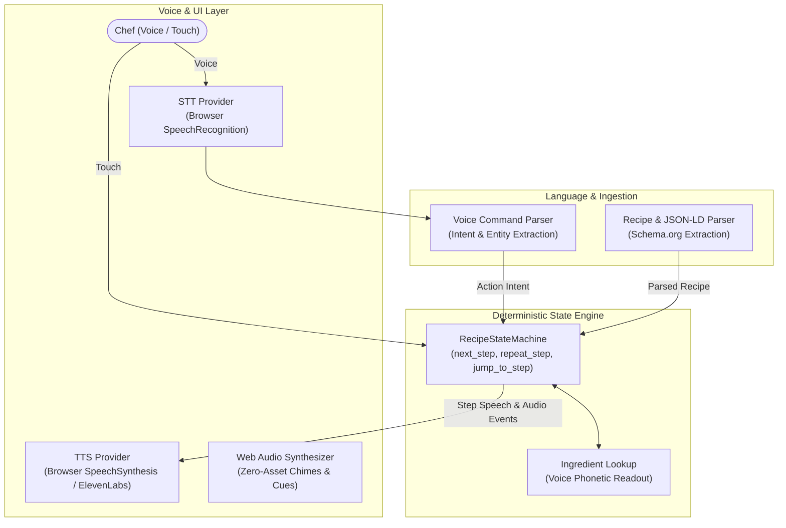
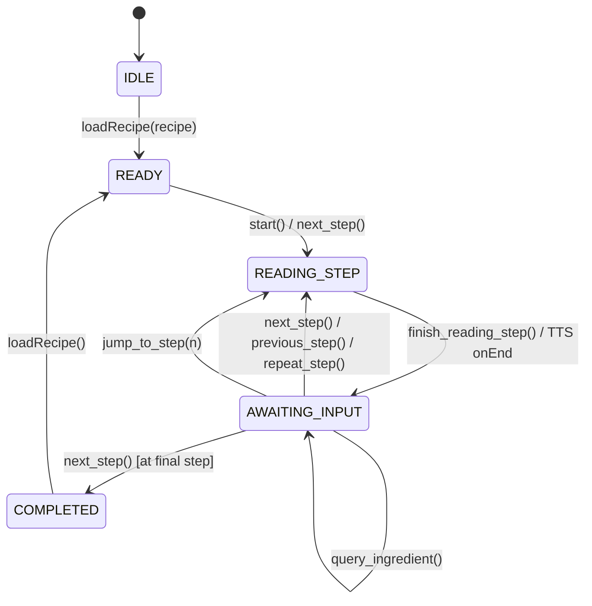

# 👩‍🍳 SousChef: Recipe Reader

> **An hands-free voice interface for kitchen recipe navigation.**  
> Built as an audio-first engineering showcase with swappable TTS/STT providers—running with native browser speech synthesis today, architected for ElevenLabs streaming voice integration.

[](file:///Users/jdsouza/aifun/recipe%20reader/test)
[](file:///Users/jdsouza/aifun/recipe%20reader/package.json)
[](file:///Users/jdsouza/aifun/recipe%20reader)
[](file:///Users/jdsouza/aifun/recipe%20reader/src/voice/tts-provider.ts)

---

## 🎯 Motivation & Design Philosophy

Kitchen environments present unique challenges for conversational voice assistants:
1. **Messy hands & distance:** Users stand 3–6 feet away from the screen; navigation must be 100% hands-free and resilient to ambient kitchen noise.
2. **Deterministic state guarantees:** Cooking recipes are sequential workflows. The assistant must never hallucinate steps, lose track of current instructions, or skip prerequisites.
3. **Echo cancellation & feedback immunity:** Speech synthesizers can trigger microphone feedback loops if the assistant hears its own voice. SousChef implements active speech suppression with post-utterance decay, multi-alternative interim matching, and instant barge-in voice interrupts.
4. **Memory stability for long-running kitchen sessions:** Voice assistants left open on countertops must never leak memory. SousChef implements active recognizer recycling, background tab visibility throttling, and a 5-minute inactivity watchdog.
5. **Lightweight, offline-first reliability:** Zero external npm dependencies. Everything runs natively using modern Web APIs and Node 24 native TypeScript execution.

---

## 🏗️ Architecture



### State Machine Lifecycle



---

## ✨ Key Features

- **Deterministic Step Traversal:** Formal `next_step()`, `previous_step()`, `repeat_step()`, and `jump_to_step()` methods with bounds checking, transition guards, and audit history logging.
- **Hands-Free Kitchen Timers & Step Duration Detection:** Set multiple concurrent timers by voice (*"Set a timer for 10 minutes"*, *"Set pasta timer for 8 minutes"*, *"How much time is left?"*, *"Cancel timer"*). SousChef automatically parses duration ranges in step text (e.g., *"Bake for 20 to 25 minutes"*) and renders interactive one-tap quick-start timer chips with synthesized Web Audio alarms.
- **Instant Interrupt / Stop:** Saying *"Stop"*, *"Pause"*, or *"Quiet"* immediately cuts off text-to-speech audio, silences active timer alarms, and cancels speech queues.
- **Echo & Feedback Suppression:** Mic input is suppressed while the assistant speaks, followed by a 650ms decay cooldown to prevent speaker audio from re-triggering commands.
- **Natural Ingredient Inquiries:** Ask *"How much butter do I need?"* or *"How many eggs?"* at any time; SousChef extracts phonetic ingredient quantities without interrupting step progress.
- **Zero-Dependency Schema.org Recipe Extractor:** Ingest any recipe URL supporting Schema.org/Recipe JSON-LD, or load pre-bundled offline recipes.
- **Swappable Audio Architecture:**
  - `TTSProvider` and `STTProvider` interfaces.
  - Active offline implementation: `window.speechSynthesis` and `window.SpeechRecognition`.
  - Ready-to-use adapter: `ElevenLabsTTSAdapter` conforming to ElevenLabs streaming REST and WebSocket contracts.

---

## 🛡️ Production Voice Hardening & Memory Architecture

Real-world hands-free kitchen voice interfaces present acute edge cases that simple prototypes overlook. SousChef solves four core voice lifecycle and stability challenges:

### 1. Chromium Speech Recognition Memory Leak Mitigation
- **The Issue:** In Chromium-based browsers, running `SpeechRecognition` in `continuous = true` mode over multi-hour sessions delegates audio streaming to Chrome's native `Utility: Speech Recognition Service`. Because browsers force-terminate recognition after periods of silence, naive implementations restart the session in an infinite loop (`onend -> start()`). Re-invoking `.start()` on the same dirty instance leaks C++ audio buffers in native memory, compounding to tens of gigabytes over 24+ hours.
- **The Solution:** On each session restart, SousChef completely detaches native event handlers (`onresult`, `onend`, `onerror`), explicitly calls `.abort()`, nullifies the reference, and instantiates a clean `SpeechRecognition` object. This enables V8 and Chromium's IPC bridge to completely sweep prior audio buffers.

### 2. Inactivity Watchdog (5-Minute Auto-Sleep)
- **The Issue:** Kitchen devices are often left unattended for hours or days after cooking.
- **The Solution:** A background inactivity watchdog monitors timestamps across voice commands, UI clicks, and keypresses. If no interaction occurs for **5 minutes**, the voice pipeline cleanly stops audio capture and enters low-power sleep mode (`💤 Mic auto-paused`), eliminating idle memory and battery drain.

### 3. Background Tab Visibility Throttling
- **The Issue:** Browsers keep recording audio even when the tab is hidden, wasting bandwidth and memory while surprising users.
- **The Solution:** Hooks into `document.visibilitychange`. If the user minimizes Chrome, switches tabs, or locks their machine, audio capture immediately terminates and enters sleep until manually awakened.

### 4. Barge-In Interrupts & Blended Audio Detection
- **The Issue:** When an assistant reads steps through laptop speakers, the microphone captures a blended acoustic stream (e.g. speaker says *"degrees"* + user says *"stop"* $\rightarrow$ Chrome transcribes *"degrees stop"*). Strict regex matching (`^stop$`) fails, dropping the interrupt.
- **The Solution:**
  - Priority #1 routing: Evaluates `STOP` intent **before** echo-suppression filters.
  - Word-boundary matching: Regex `\b(stop|pause|quiet|silence|halt)\b` catches interrupts even when surrounded by speaker bleed or conversational prefixes.
  - Multi-alternative hypothesis scanning: Scans interim recognition alternatives so that if "stop" appears as a secondary hypothesis against loud speaker output, speech synthesis is halted immediately.
  - Audio buffer flush: Invokes `synth.pause()` immediately before `synth.cancel()` to force Chromium's audio thread to dump buffered audio without latency.

---

## 🧪 Comprehensive Offline Test Suite

SousChef includes 43 unit and integration tests executing natively in Node 24 with **zero external dependencies**:

```bash
npm test
```

### Test Coverage Highlights

| Test Suite | Focus Areas | Tests | Status |
| :--- | :--- | :---: | :---: |
| [state-machine.test.ts](file:///Users/jdsouza/aifun/recipe%20reader/test/state-machine.test.ts) | State transitions, sequential traversal, bounds, observers, state snapshots | 20 | ✅ Passed |
| [recipe-scaler.test.ts](file:///Users/jdsouza/aifun/recipe%20reader/test/recipe-scaler.test.ts) | Fraction parsing, unicode normalization, phonetic voice text formatting | 10 | ✅ Passed |
| [recipe-parser.test.ts](file:///Users/jdsouza/aifun/recipe%20reader/test/recipe-parser.test.ts) | Schema.org JSON-LD extraction, ISO durations, yield parsing | 6 | ✅ Passed |
| [command-parser.test.ts](file:///Users/jdsouza/aifun/recipe%20reader/test/command-parser.test.ts) | Natural language voice intent classification & STOP interrupts | 6 | ✅ Passed |
| [integration.test.ts](file:///Users/jdsouza/aifun/recipe%20reader/test/integration.test.ts) | Full cooking lifecycle: load $\rightarrow$ query $\rightarrow$ traverse $\rightarrow$ interrupt $\rightarrow$ complete | 1 | ✅ Passed |
| **Total** | | **43** | **100% Pass** |

---

## 🚀 Running the Browser Kitchen UI

Start the local server:

```bash
npm start
```

Open your browser at:
```
http://localhost:3000
```

*(Alternatively, open [public/index.html](file:///Users/jdsouza/aifun/recipe%20reader/public/index.html) directly in any modern browser—offline sample recipes work with zero server required!)*

### Voice Commands Supported

- **Progression:** `"Next"`, `"Next step"`, `"What's next"`, `"Done"`
- **Repetition:** `"Repeat"`, `"Say that again"`, `"What was that"`
- **Backtracking:** `"Back"`, `"Previous step"`, `"Go back"`
- **Navigation:** `"Jump to step 4"`, `"Go to step 2"`
- **Interruption / Stop:** `"Stop"`, `"Pause"`, `"Quiet"`, `"Be quiet"`, `"Silence"`
- **Ingredient Queries:** `"How much butter do I need?"`, `"How many eggs?"`, `"List ingredients"`

---

## 🎙️ Transitioning to ElevenLabs

When you are ready to plug in ElevenLabs studio voices:

1. Look at [src/voice/tts-provider.ts](file:///Users/jdsouza/aifun/recipe%20reader/src/voice/tts-provider.ts). The `ElevenLabsTTSAdapter` implements the identical `TTSProvider` contract:
```typescript
import { ElevenLabsTTSAdapter } from './src/voice/tts-provider.ts';

const tts = new ElevenLabsTTSAdapter({
  apiKey: process.env.ELEVENLABS_API_KEY,
  voiceId: '21m00Tcm4TlvDq8ikWAM', // Rachel
  modelId: 'eleven_turbo_v2_5'
});

await tts.speak("Step 1. Preheat your oven to 375 degrees.");
```
2. The state machine and command parser require zero modifications—audio delivery is completely decoupled from recipe logic!

---

## 📂 Project Structure

```
recipe-reader/
├── package.json               # Zero-dependency configuration & test scripts
├── server.js                  # Native HTTP server & URL recipe extractor
├── src/
│   ├── core/
│   │   ├── types.ts           # Core types, events & state snapshot definitions
│   │   ├── state-machine.ts   # Deterministic RecipeStateMachine
│   │   ├── recipe-scaler.ts   # Fraction math & voice phonetic formatting
│   │   └── recipe-parser.ts   # Schema.org JSON-LD extractor
│   ├── voice/
│   │   ├── command-parser.ts  # Voice intent classification & STOP interrupts
│   │   ├── tts-provider.ts    # TTSProvider interface + Browser & ElevenLabs adapters
│   │   └── stt-provider.ts    # SpeechRecognition manager with echo suppression
│   ├── audio/
│   │   └── sound-effects.ts   # Synthesized Web Audio chimes (zero MP3 assets needed)
│   └── fixtures/
│       └── sample-recipes.ts  # Offline test fixtures
├── public/
│   ├── index.html             # High-contrast kitchen mode interface
│   ├── style.css              # Dark kitchen UI theme
│   └── app.js                 # Browser application controller
└── test/
    ├── state-machine.test.ts  # State machine tests
    ├── recipe-scaler.test.ts  # Scaler & fraction tests
    ├── recipe-parser.test.ts  # Parser tests
    ├── command-parser.test.ts # Intent classification tests
    └── integration.test.ts    # End-to-end cooking session simulation
```

---

## 📜 License

MIT
