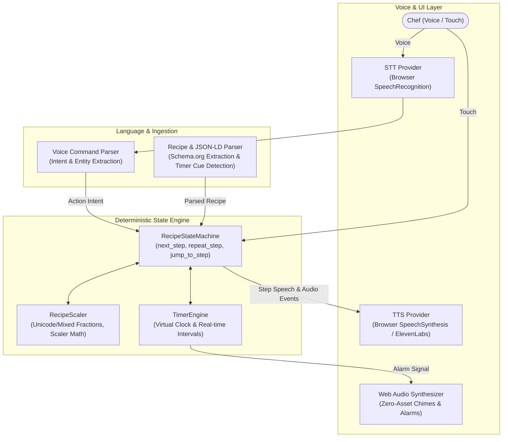
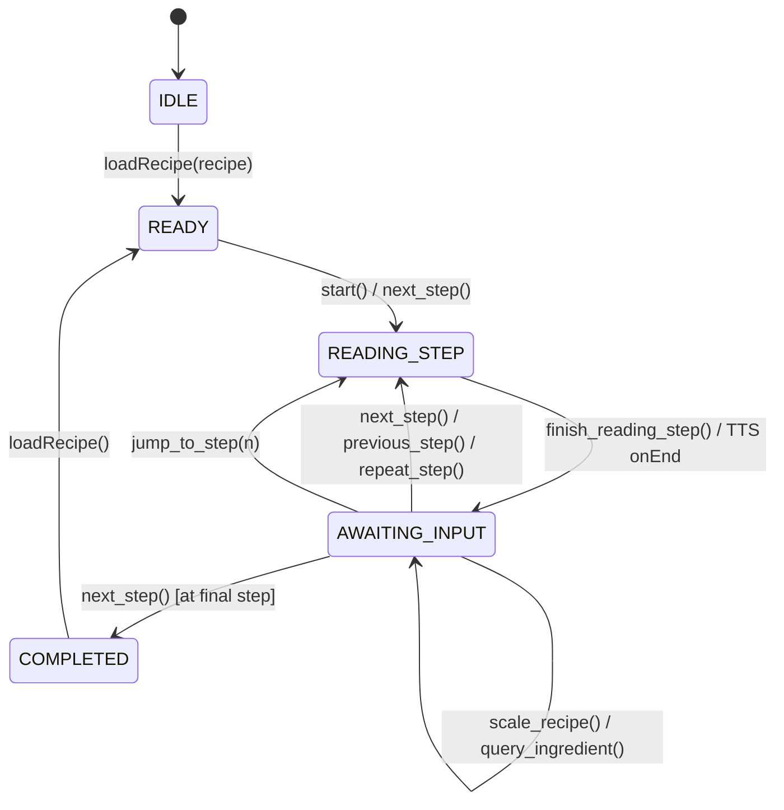

# 👩‍🍳 SousChef: Deterministic Recipe Voice State Machine

> **An offline-first, deterministic state machine and hands-free voice interface for kitchen recipe navigation.**  
> Built as an audio-first engineering showcase with swappable TTS/STT providers—running with native browser speech synthesis today, architected for ElevenLabs streaming voice integration.

[](file:///Users/jdsouza/aifun/recipe%20reader/public/manifest.json)
[](file:///Users/jdsouza/aifun/recipe%20reader/test)
[](file:///Users/jdsouza/aifun/recipe%20reader/package.json)
[](file:///Users/jdsouza/aifun/recipe%20reader)
[](file:///Users/jdsouza/aifun/recipe%20reader/src/voice/tts-provider.ts)

---

## 🎯 Motivation & Design Philosophy

Kitchen environments present unique challenges for conversational voice assistants:
1. **Messy hands & distance:** Users stand 3–6 feet away from the screen; navigation must be 100% hands-free and resilient to ambient kitchen noise.
2. **Deterministic state guarantees:** Cooking recipes are sequential workflows. The assistant must never hallucinate steps, lose track of current instructions, or skip prerequisites.
3. **Ingredient mathematics:** Scaling 24 cookies to 36 requires deterministic fraction parsing (e.g., $2 \frac{1}{4}\text{ cups} \times 1.5 = 3 \frac{3}{8}\text{ cups}$), unit preservation, and spoken pronunciation mapping for natural TTS.
4. **Asynchronous timer orchestration:** Cooking involves concurrent background timers that must interrupt or queue audio without desynchronizing the step reader.

---

## 📱 Progressive Web App (PWA) & Kitchen Utilities

SousChef is an installable, standalone **Progressive Web App**:
- **Offline Caching:** Powered by [public/sw.js](file:///Users/jdsouza/aifun/recipe%20reader/public/sw.js) (Cache-First app shell + Stale-While-Revalidate recipe storage).
- **Web App Manifest:** Configured in [public/manifest.json](file:///Users/jdsouza/aifun/recipe%20reader/public/manifest.json) with custom 192x192 & 512x512 maskable SVG icons and app shortcuts.
- **Screen Wake Lock API:** Built-in "👁️ Keep Awake" toggle prevents tablets and phones from dimming/sleeping while hands are messy in the kitchen.
- **Install Prompt:** Automatic native install prompt banner (`beforeinstallprompt`) on desktop Chrome, Android, Edge, and iOS Safari ("Add to Home Screen").

---

## 🏗️ Architecture



### State Machine Lifecycle



---

## ✨ Key Features

- **Deterministic Transitions:** Formal `next_step()`, `previous_step()`, `repeat_step()`, and `jump_to_step()` methods with bounds checking and complete history logging.
- **Intelligent Ingredient Scaler:**
  - Handles unicode fractions (`½`, `¼`, `¾`, `⅓`, `⅔`, `⅛`), compound fractions (`1 1/2`), decimals, and ranges.
  - Scales up or down deterministically and outputs natural spoken phonetic representations for speech synthesis (e.g. `1 1/2` $\rightarrow$ *"one and a half cups of flour"*).
- **Automated Step Timer Detection:**
  - Scans step instructions for duration phrases (e.g. *"simmer covered for 15 minutes"*, *"bake for 25 to 30 mins"*, *"rest for 1 hour"*) and automatically prompts/configures active countdown timers.
- **Deterministic Virtual Clock:**
  - Timers can be driven in real-time ($1000\text{ms}$) or stepped with simulated delta ticks (`tick(deltaSeconds)`), allowing entire 45-minute cooking sessions to be tested in milliseconds without flaky async sleeps.
- **Swappable Audio Architecture:**
  - `TTSProvider` and `STTProvider` interfaces.
  - Active offline implementation: `window.speechSynthesis` and `window.SpeechRecognition`.
  - Ready-to-use adapter: `ElevenLabsTTSAdapter` conforming to ElevenLabs streaming REST and WebSocket contracts.

---

## 🧪 Comprehensive Offline Test Suite

SousChef includes 61 unit and integration tests executing natively in Node 24 with **zero external dependencies**:

```bash
npm test
```

### Test Coverage Highlights

| Test Suite | Focus Areas | Tests | Status |
| :--- | :--- | :---: | :---: |
| [state-machine.test.ts](file:///Users/jdsouza/aifun/recipe%20reader/test/state-machine.test.ts) | State transitions, sequential traversal, bounds, observers, state snapshots | 21 | ✅ Passed |
| [recipe-scaler.test.ts](file:///Users/jdsouza/aifun/recipe%20reader/test/recipe-scaler.test.ts) | Fraction parsing, unicode normalization, scaling mathematics, phonetic voice text | 15 | ✅ Passed |
| [timer-engine.test.ts](file:///Users/jdsouza/aifun/recipe%20reader/test/timer-engine.test.ts) | Start, pause, resume, cancel, virtual clock ticking, expiration listeners | 6 | ✅ Passed |
| [recipe-parser.test.ts](file:///Users/jdsouza/aifun/recipe%20reader/test/recipe-parser.test.ts) | Schema.org JSON-LD extraction, duration regex heuristics, yield parsing | 10 | ✅ Passed |
| [command-parser.test.ts](file:///Users/jdsouza/aifun/recipe%20reader/test/command-parser.test.ts) | Natural language voice intent classification & entity extraction | 8 | ✅ Passed |
| [integration.test.ts](file:///Users/jdsouza/aifun/recipe%20reader/test/integration.test.ts) | Full cooking lifecycle: load $\rightarrow$ scale $\rightarrow$ query $\rightarrow$ step timers $\rightarrow$ complete | 1 | ✅ Passed |
| **Total** | | **61** | **100% Pass** |

---

## 🚀 Running the Browser Kitchen UI

Start the local server:

```bash
npm start
```

Open your browser at:
```
http://localhost:3000
```

*(Alternatively, open [public/index.html](file:///Users/jdsouza/aifun/recipe%20reader/public/index.html) directly in any modern browser—offline sample recipes work with zero server required!)*

### Voice Commands Supported

- **Progression:** `"Next"`, `"Next step"`, `"What's next"`, `"Done"`
- **Repetition:** `"Repeat"`, `"Say that again"`, `"What was that"`
- **Backtracking:** `"Back"`, `"Previous step"`, `"Go back"`
- **Navigation:** `"Jump to step 4"`, `"Go to step 2"`
- **Scaling:** `"Scale to 6 servings"`, `"Double the recipe"`, `"Half the recipe"`
- **Ingredient Queries:** `"How much butter do I need?"`, `"How many eggs?"`, `"List ingredients"`
- **Timer Control:** `"Set a timer for 10 minutes"`, `"Pause timer"`, `"Cancel timer"`

---

## 🎙️ Transitioning to ElevenLabs

When you are ready to plug in ElevenLabs studio voices:

1. Look at [src/voice/tts-provider.ts](file:///Users/jdsouza/aifun/recipe%20reader/src/voice/tts-provider.ts#L170). The `ElevenLabsTTSAdapter` implements the identical `TTSProvider` contract:
```typescript
import { ElevenLabsTTSAdapter } from './src/voice/tts-provider.ts';

const tts = new ElevenLabsTTSAdapter({
  apiKey: process.env.ELEVENLABS_API_KEY,
  voiceId: '21m00Tcm4TlvDq8ikWAM', // Rachel
  modelId: 'eleven_turbo_v2_5'
});

await tts.speak("Step 1. Preheat your oven to 375 degrees.");
```
2. The state machine and command parser require zero modifications—audio delivery is completely decoupled from recipe logic!

---

## 📂 Project Structure

```
recipe-reader/
├── package.json               # Zero-dependency configuration & scripts
├── server.js                  # Native HTTP server & URL recipe extractor
├── src/
│   ├── core/
│   │   ├── types.ts           # Core types, events & snapshots
│   │   ├── state-machine.ts   # Deterministic RecipeStateMachine
│   │   ├── recipe-scaler.ts   # Fraction math & voice phonetic formatting
│   │   ├── timer-engine.ts    # Virtual clock & timer management
│   │   └── recipe-parser.ts   # Schema.org JSON-LD extractor & timer detection
│   ├── voice/
│   │   ├── command-parser.ts  # Voice intent classification
│   │   ├── tts-provider.ts    # TTSProvider interface + Browser & ElevenLabs adapters
│   │   └── stt-provider.ts    # Continuous SpeechRecognition manager
│   ├── audio/
│   │   └── sound-effects.ts   # Synthesized Web Audio chimes (zero MP3s needed)
│   └── fixtures/
│       └── sample-recipes.ts  # Offline test fixtures
├── public/
│   ├── index.html             # High-contrast kitchen mode interface
│   ├── style.css              # Modern culinary dark theme
│   └── app.js                 # Browser application controller
└── test/
    ├── state-machine.test.ts  # 21 state machine tests
    ├── recipe-scaler.test.ts  # 15 scaler tests
    ├── timer-engine.test.ts   # 6 timer tests
    ├── recipe-parser.test.ts  # 10 parser tests
    ├── command-parser.test.ts # 8 intent classification tests
    └── integration.test.ts    # End-to-end cooking session simulation
```

---

## 📜 License

MIT
