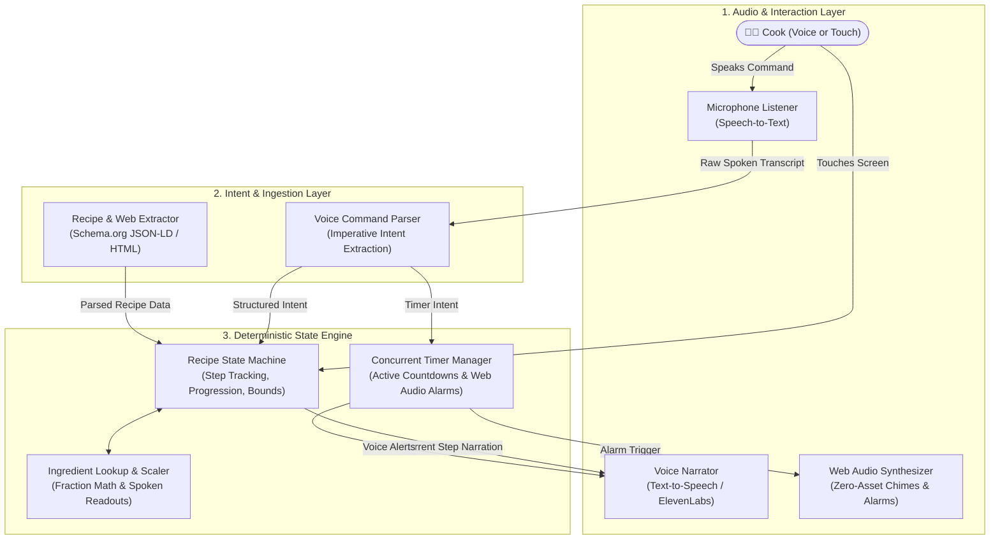
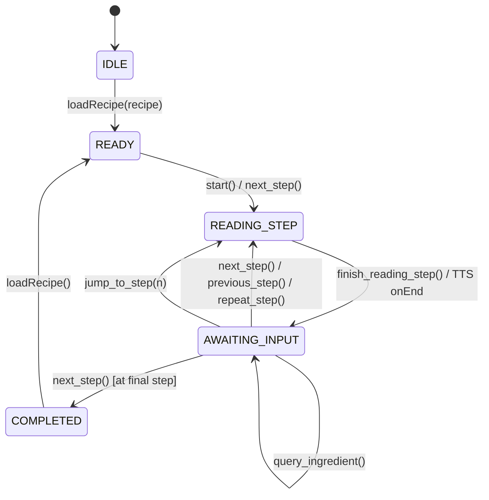

# 👩‍🍳 SousChef: Recipe Reader

> **An hands-free voice interface for kitchen recipe navigation.**  
> Built as an audio-first engineering showcase with swappable TTS/STT providers—running with native browser speech synthesis today, architected for ElevenLabs streaming voice integration.

[](file:///Users/jdsouza/aifun/recipe%20reader/test)
[](file:///Users/jdsouza/aifun/recipe%20reader/package.json)
[](file:///Users/jdsouza/aifun/recipe%20reader)
[](file:///Users/jdsouza/aifun/recipe%20reader/src/voice/tts-provider.ts)

---

## 🎯 Motivation & Design Philosophy

Kitchen environments present unique challenges for conversational voice assistants:
1. **Messy hands & distance:** Users stand 3–6 feet away from the screen; navigation must be 100% hands-free and resilient to ambient kitchen noise.
2. **Deterministic state guarantees:** Cooking recipes are sequential workflows. The assistant must never hallucinate steps, lose track of current instructions, or skip prerequisites.
3. **Echo cancellation & feedback immunity:** Speech synthesizers can trigger microphone feedback loops if the assistant hears its own voice. SousChef implements active speech suppression with post-utterance decay, multi-alternative interim matching, and instant barge-in voice interrupts.
4. **Memory stability for long-running kitchen sessions:** Voice assistants left open on countertops must never leak memory. SousChef implements active recognizer recycling, background tab visibility throttling, and a 5-minute inactivity watchdog.
5. **Lightweight, offline-first reliability:** Zero external npm dependencies. Everything runs natively using modern Web APIs and Node 24 native TypeScript execution.

---

## 🏗️ System Architecture

SousChef is organized into three clean layers designed for deterministic, hands-free kitchen interaction:



### Data Flow
1. **Audio & Interaction Layer:** Captures audio through the browser's microphone and plays back spoken instructions and Web Audio harmonic chimes without external audio assets.
2. **Intent & Ingestion Layer:** Ingests recipes from any website supporting Schema.org/Recipe structured data, and classifies spoken user commands using deterministic, noise-resilient natural language matching.
3. **Deterministic State Engine:** Manages recipe step progression, concurrent cooking timers, and ingredient scaling with strict transition bounds so the assistant never skips steps or hallucinates.

### State Machine Lifecycle



---

## ✨ Key Features

- **Deterministic Step Traversal:** Formal `next_step()`, `previous_step()`, `repeat_step()`, and `jump_to_step()` methods with bounds checking, transition guards, and audit history logging.
- **Hands-Free Kitchen Timers & Step Duration Detection:** Set multiple concurrent timers by voice (*"Set a timer for 10 minutes"*, *"Set pasta timer for 8 minutes"*, *"How much time is left?"*, *"Cancel timer"*). SousChef automatically parses duration ranges in step text (e.g., *"Bake for 20 to 25 minutes"*) and renders interactive one-tap quick-start timer chips with synthesized Web Audio alarms.
- **Instant Interrupt / Stop:** Saying *"Stop"*, *"Pause"*, or *"Quiet"* immediately cuts off text-to-speech audio, silences active timer alarms, and cancels speech queues.
- **Echo & Feedback Suppression:** Mic input is suppressed while the assistant speaks, followed by a 650ms decay cooldown to prevent speaker audio from re-triggering commands.
- **Natural Ingredient Inquiries:** Ask *"How much butter do I need?"* or *"How many eggs?"* at any time; SousChef extracts phonetic ingredient quantities without interrupting step progress.
- **Zero-Dependency Schema.org Recipe Extractor:** Ingest any recipe URL supporting Schema.org/Recipe JSON-LD, or load pre-bundled offline recipes.
- **Swappable Audio Architecture:**
  - `TTSProvider` and `STTProvider` interfaces.
  - Active offline implementation: `window.speechSynthesis` and `window.SpeechRecognition`.
  - Ready-to-use adapter: `ElevenLabsTTSAdapter` conforming to ElevenLabs streaming REST and WebSocket contracts.

---

## 🛡️ Edge-Case Voice Engineering

Kitchen environments present unique full-duplex audio challenges. SousChef solves four core edge cases:

| Challenge | Real-World Failure | SousChef Solution |
| :--- | :--- | :--- |
| **Acoustic Self-Feedback** | Assistant's voice bleeds into mic, re-triggering recursive timer/step loops | **Imperative Grammar:** Strictly requires leading command verbs (`^set a timer`) and rejects descriptive confirmations (`"timer started"`), backed by a 3s deduplication guard. |
| **Chromium Memory Leaks** | Continuous Web Speech leaks C++ buffers over multi-hour sessions | **Instance Recycling:** Explicitly detaches handlers, aborts, and instantiates a clean `SpeechRecognition` object on restart. |
| **Barge-In Interrupts** | User saying "Stop" blends with speaker audio into a single transcript | **Boundary & Alt-Scanning:** Priority #1 `\bstop\b` matching across interim recognition alternatives with instant buffer flush. |
| **Countertop Idle Drain** | Open kitchen tabs drain battery and leave mic active unattended | **Auto-Sleep Watchdog:** 5-minute inactivity timer and `visibilitychange` background throttling. |

---

## 🧪 Comprehensive Offline Test Suite

SousChef includes 53 unit and integration tests executing natively in Node 24 with **zero external dependencies**:

```bash
npm test
```

### Test Coverage Highlights

| Test Suite | Focus Areas | Tests | Status |
| :--- | :--- | :---: | :---: |
| [state-machine.test.ts](file:///Users/jdsouza/aifun/recipe%20reader/test/state-machine.test.ts) | State transitions, sequential traversal, bounds, observers, state snapshots | 20 | ✅ Passed |
| [recipe-scaler.test.ts](file:///Users/jdsouza/aifun/recipe%20reader/test/recipe-scaler.test.ts) | Fraction parsing, unicode normalization, phonetic voice text formatting | 10 | ✅ Passed |
| [command-parser.test.ts](file:///Users/jdsouza/aifun/recipe%20reader/test/command-parser.test.ts) | Voice intent classification, step timers, feedback exclusions & interrupts | 16 | ✅ Passed |
| [recipe-parser.test.ts](file:///Users/jdsouza/aifun/recipe%20reader/test/recipe-parser.test.ts) | Schema.org JSON-LD extraction, ISO durations, yield parsing | 6 | ✅ Passed |
| [integration.test.ts](file:///Users/jdsouza/aifun/recipe%20reader/test/integration.test.ts) | Full cooking lifecycle: load $\rightarrow$ query $\rightarrow$ traverse $\rightarrow$ interrupt $\rightarrow$ complete | 1 | ✅ Passed |
| **Total** | | **53** | **100% Pass** |

---

## 🚀 Running the Browser Kitchen UI

Start the local server:

```bash
npm start
```

Open your browser at:
```
http://localhost:3000
```

*(Alternatively, open [public/index.html](file:///Users/jdsouza/aifun/recipe%20reader/public/index.html) directly in any modern browser—offline sample recipes work with zero server required!)*

### Voice Commands Supported

- **Progression:** `"Next"`, `"Next step"`, `"What's next"`, `"Done"`
- **Repetition:** `"Repeat"`, `"Say that again"`, `"What was that"`
- **Backtracking:** `"Back"`, `"Previous step"`, `"Go back"`
- **Navigation:** `"Jump to step 4"`, `"Go to step 2"`
- **Interruption / Stop:** `"Stop"`, `"Pause"`, `"Quiet"`, `"Be quiet"`, `"Silence"`
- **Ingredient Queries:** `"How much butter do I need?"`, `"How many eggs?"`, `"List ingredients"`

---

## 🎙️ Transitioning to ElevenLabs

When you are ready to plug in ElevenLabs studio voices:

1. Look at [src/voice/tts-provider.ts](file:///Users/jdsouza/aifun/recipe%20reader/src/voice/tts-provider.ts). The `ElevenLabsTTSAdapter` implements the identical `TTSProvider` contract:
```typescript
import { ElevenLabsTTSAdapter } from './src/voice/tts-provider.ts';

const tts = new ElevenLabsTTSAdapter({
  apiKey: process.env.ELEVENLABS_API_KEY,
  voiceId: '21m00Tcm4TlvDq8ikWAM', // Rachel
  modelId: 'eleven_turbo_v2_5'
});

await tts.speak("Step 1. Preheat your oven to 375 degrees.");
```
2. The state machine and command parser require zero modifications—audio delivery is completely decoupled from recipe logic!

---

## 📜 License

MIT
