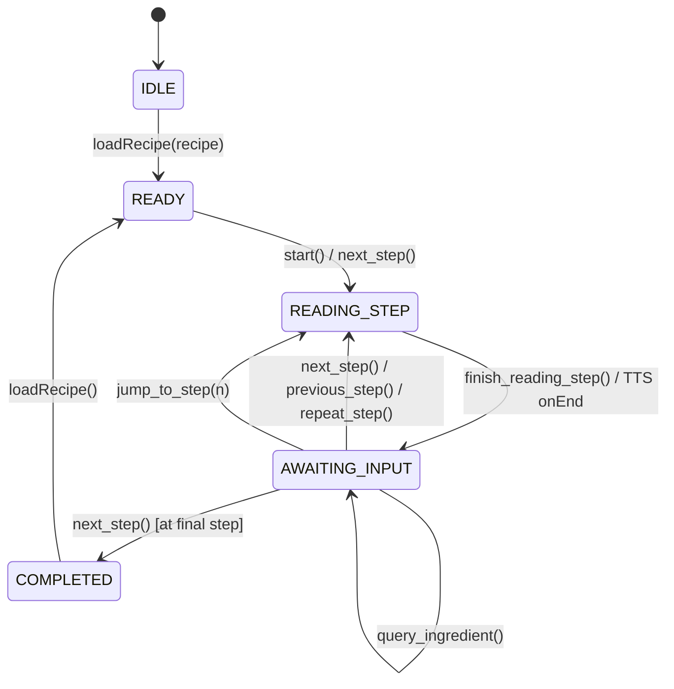

# 👩‍🍳 SousChef: A Hands-Free Voice Interface for Kitchen Recipe Navigation

Kitchen environments present unique challenges for conversational voice assistants and 
When cooking, it's difficult to be constantly checking your screen for the next step or to be reminded of how much of an ingredient is required. SousChef solves this problem by providing a hands-free voice interface for recipe navigation.

Works offline out of the box using your browser's built-in voice, with a plug-and-play architecture ready for ElevenLabs AI voices to bring warmth and natural, human narration to the kitchen.

1. **Messy hands & distance:** Users stand several feet away from the screen; navigation is 100% hands-free and operates using clear voice commands.
2. **Deterministic step progression:** Cooking is a step-by-step workflow. The state machine guarantees steps are read in order without hallucinating, skipping ahead, or losing state.
3. **Echo suppression & feedback prevention:** When the assistant speaks, mic input is automatically suppressed with a cooldown period so the device doesn't hear and re-execute its own voice.
4. **Countertop stability:** The app stays reliable during long sessions by pausing listening when the browser tab is minimized, recycling speech listeners, and sleeping after 5 minutes of inactivity.
5. **Zero external dependencies:** Runs entirely on native Web Speech, Web Audio, and Node 24 native TypeScript execution—no npm packages to install.
6. **Kitchen-first UI:** Designed and prototyped in **Figma** with large typography and high-contrast buttons readable from across the counter, built with clean semantic HTML and CSS.

---

## 🏗️ System Architecture

SousChef is organized into three clean layers designed for deterministic, hands-free kitchen interaction:


### Data Flow
1. **Audio & Interaction Layer:** Captures audio through the browser's microphone and plays back spoken instructions and Web Audio harmonic chimes without external audio assets.
2. **Intent & Ingestion Layer:** Ingests recipes from any website supporting Schema.org/Recipe structured data, and classifies spoken user commands using deterministic, noise-resilient natural language matching.
3. **Deterministic State Engine:** Manages recipe step progression, concurrent cooking timers, and ingredient scaling with strict transition bounds so the assistant never skips steps or hallucinates.

### State Machine Lifecycle



---

## ✨ Key Features

- **Deterministic Step Traversal:** Formal `next_step()`, `previous_step()`, `repeat_step()`, and `jump_to_step()` methods with bounds checking, transition guards, and audit history logging.
- **Hands-Free Kitchen Timers & Step Duration Detection:** Set multiple concurrent timers by voice (*"Set a timer for 10 minutes"*, *"Set pasta timer for 8 minutes"*, *"How much time is left?"*, *"Cancel timer"*). SousChef automatically parses duration ranges in step text (e.g., *"Bake for 20 to 25 minutes"*) and renders interactive one-tap quick-start timer chips with synthesized Web Audio alarms.
- **Instant Interrupt / Stop:** Saying *"Stop"*, *"Pause"*, or *"Quiet"* immediately cuts off text-to-speech audio, silences active timer alarms, and cancels speech queues.
- **Echo & Feedback Suppression:** Mic input is suppressed while the assistant speaks, followed by a 650ms decay cooldown to prevent speaker audio from re-triggering commands.
- **Natural Ingredient Inquiries:** Ask *"How much butter do I need?"* or *"How many eggs?"* at any time; SousChef extracts phonetic ingredient quantities without interrupting step progress.
- **Zero-Dependency Schema.org Recipe Extractor:** Ingest any recipe URL supporting Schema.org/Recipe JSON-LD, or load pre-bundled offline recipes.
- **Swappable Audio Architecture:**
  - `TTSProvider` and `STTProvider` interfaces.
  - Active offline implementation: Native `window.speechSynthesis` and `window.SpeechRecognition`.
  - Ready-to-use adapter: `ElevenLabsTTSAdapter` for ultra-realistic studio voices.
  - **Zero-cost offline fallback:** When ElevenLabs is unconfigured, rate-limited, or offline, the app automatically falls back to browser speech synthesis.

---

## 🛡️ Edge-Case Voice Engineering

Kitchen environments present unique full-duplex audio challenges. SousChef solves four core edge cases:

| Challenge | Real-World Failure | SousChef Solution |
| :--- | :--- | :--- |
| **Acoustic Self-Feedback** | Assistant's voice bleeds into mic, re-triggering recursive timer/step loops | **Imperative Grammar:** Strictly requires leading command verbs (`^set a timer`) and rejects descriptive confirmations (`"timer started"`), backed by a 3s deduplication guard. |
| **Chromium Memory Leaks** | Continuous Web Speech leaks C++ buffers over multi-hour sessions | **Instance Recycling:** Explicitly detaches handlers, aborts, and instantiates a clean `SpeechRecognition` object on restart. |
| **Barge-In Interrupts** | User saying "Stop" blends with speaker audio into a single transcript | **Boundary & Alt-Scanning:** Priority #1 `\bstop\b` matching across interim recognition alternatives with instant buffer flush. |
| **Countertop Idle Drain** | Open kitchen tabs drain battery and leave mic active unattended | **Auto-Sleep Watchdog:** 5-minute inactivity timer and `visibilitychange` background throttling. |

---

## 🚀 Getting Started

Run tests:
```bash
npm test
```

Start the local server:
```bash
npm start
```

Open your browser at:
```
http://localhost:3000
```

*(Alternatively, open [public/index.html](file:///Users/jdsouza/aifun/recipe%20reader/public/index.html) directly in any modern browser—offline sample recipes work with zero server required!)*

### Voice Commands Supported

- **Progression:** `"Next"`, `"Next step"`, `"What's next"`, `"Done"`
- **Repetition:** `"Repeat"`, `"Say that again"`, `"What was that"`
- **Backtracking:** `"Back"`, `"Previous step"`, `"Go back"`
- **Navigation:** `"Jump to step 4"`, `"Go to step 2"`
- **Interruption / Stop:** `"Stop"`, `"Pause"`, `"Quiet"`, `"Be quiet"`, `"Silence"`
- **Ingredient Queries:** `"How much butter do I need?"`, `"How many eggs?"`, `"List ingredients"`

---

## 🎙️ Transitioning to ElevenLabs

When you are ready to plug in ElevenLabs studio voices:

1. Look at [src/voice/tts-provider.ts](file:///Users/jdsouza/aifun/recipe%20reader/src/voice/tts-provider.ts). The `ElevenLabsTTSAdapter` implements the identical `TTSProvider` contract:
```typescript
import { ElevenLabsTTSAdapter } from './src/voice/tts-provider.ts';

const tts = new ElevenLabsTTSAdapter({
  apiKey: process.env.ELEVENLABS_API_KEY,
  voiceId: '21m00Tcm4TlvDq8ikWAM', // Rachel
  modelId: 'eleven_turbo_v2_5'
});

await tts.speak("Step 1. Preheat your oven to 375 degrees.");
```
2. The state machine and command parser require zero modifications—audio delivery is completely decoupled from recipe logic!
3. **Automatic Offline Fallback:** If no API key is set, or if you're cooking offline without internet, SousChef seamlessly falls back to the browser's built-in `window.speechSynthesis` with zero configuration or cost.
